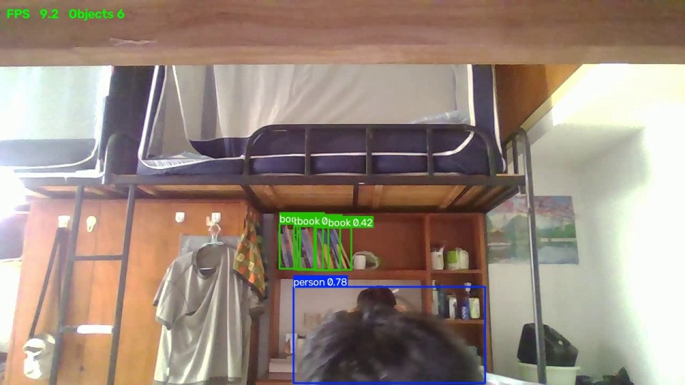

# YOLO 摄像头实时目标检测

基于 **Ultralytics YOLO11** 的极简实时检测项目：打开电脑摄像头，实时框出画面里的物品，标注**类别**与**置信度**，按 `q` / `ESC` 即可退出。





---

## 一、功能

- ✅ 调用电脑**内置摄像头**或**外接 USB 摄像头**，实时读取视频画面
- ✅ 命令行指定摄像头编号：`python detect.py 1`
- ✅ 使用 **YOLO11n 预训练模型**检测画面中的常见物品（COCO 80 类）
- ✅ 绘制**检测框 + 类别名 + 置信度**
- ✅ 左上角实时显示 **FPS**（指数平滑，读数稳定）
- ✅ 按 `s` 一键**截图**，保存为 `shot_时间戳.jpg`
- ✅ 按 `q` / `ESC` **正常退出**，自动释放摄像头
- ✅ 额外提供完整版 `detect_full.py`：支持指定摄像头编号、读视频文件、录制结果、按类别过滤

---

## 二、运行环境

| 项目 | 版本 |
|---|---|
| 操作系统 | **Ubuntu 22.04.5 LTS**（x86_64，glibc 2.35） |
| Python | **3.11.18**（conda 环境 `task`） |
| PyTorch | **2.15.0+cpu**（CPU 版） |
| TorchVision | 0.29.2+cpu |
| Ultralytics | **8.4.194** |
| OpenCV | **5.0.0.93** |
| NumPy | 2.4.6 |
| 硬件 | 无独立显卡，CPU 推理；内置摄像头 `/dev/video0` |
| 桌面会话 | Wayland（OpenCV 的 Qt 走 XWayland） |

> 有 NVIDIA 显卡时把 PyTorch 换成 CUDA 版（见「依赖说明」），帧率可提升到 30+ FPS。

---

## 三、项目结构

```
.
├── detect.py            # 主程序（38 行）
├── detect_full.py       # 完整版：命令行参数 / 录像 / 类别过滤 / 无窗口模式
├── run.sh               # 一键启动（自动激活 conda 环境）
├── download_model.sh    # 下载模型权重（官方源失败自动切镜像）
├── requirements.txt     # pip 依赖清单（版本锁定）
├── environment.yml      # conda 环境定义
├── .gitignore           # 忽略虚拟环境、缓存、权重等
├── assets/
│   └── demo.jpg         # 运行效果截图
└── README.md
```

---

## 四、快速开始

### 1. 创建 conda 环境

```bash
conda create -n task python=3.11 -y
conda activate task
```

也可以用环境文件创建：

```bash
conda env create -f environment.yml
conda activate task
```

### 2. 安装依赖

```bash
pip install -r requirements.txt
```

国内网络可加清华源加速：

```bash
pip install -r requirements.txt -i https://pypi.tuna.tsinghua.edu.cn/simple
```

> `requirements.txt` 里已通过 `--extra-index-url` 指向 PyTorch 官方 CPU 源，
> 因为 `torch==2.15.0+cpu` 这种 `+cpu` 构建只存在于该源，PyPI 上没有。

### 3. 获取模型权重

```bash
./download_model.sh          # 先试官方 GitHub，失败自动切国内镜像
```

或手动下载（推荐国内镜像）：

```bash
curl -L -o yolo11n.pt \
  "https://ghproxy.net/https://github.com/ultralytics/assets/releases/download/v8.3.0/yolo11n.pt"
```

也可以跳过这一步，直接运行 `python detect.py`，Ultralytics 会自动下载；
但**国内直连 GitHub 经常超时**，所以建议手动下载。

### 4. 运行

```bash
python detect.py          # 默认摄像头 0
python detect.py 1        # 使用 1 号摄像头（外接 USB 摄像头）
```

或使用一键脚本（自动激活环境，参数同样透传）：

```bash
./run.sh
./run.sh 1                # 等价于 python detect.py 1
```

**快捷键**：

| 按键 | 作用 |
|---|---|
| `q` / `ESC` | 退出程序并释放摄像头 |
| `s` | 保存当前画面为 `shot_YYYYMMDD_HHMMSS.jpg` |

---

## 五、代码说明（38 行）

```python
import sys
import time

import cv2
from ultralytics import YOLO

model = YOLO("yolo11n.pt")                 # 预训练模型
cam = int(sys.argv[1]) if len(sys.argv) > 1 else 0   # 摄像头编号，默认 0
cap = cv2.VideoCapture(cam)
if not cap.isOpened():
    sys.exit(f"无法打开摄像头 {cam}（可能被占用或不存在），可试编号 0 / 1 / 2")
t_prev, fps = time.time(), 0.0

while True:
    ok, frame = cap.read()                 # 读一帧
    if not ok:
        break

    img = model.predict(frame, conf=0.25, verbose=False)[0].plot()  # 检测 + 画框

    now = time.time()
    inst = 1.0 / (now - t_prev)            # 相邻两帧间隔 → 瞬时帧率
    fps = inst if fps == 0 else fps * 0.9 + inst * 0.1   # 指数平滑，读数更稳
    t_prev = now

    cv2.putText(img, f"FPS {fps:5.1f}", (12, 34),
                cv2.FONT_HERSHEY_SIMPLEX, 0.9, (0, 255, 0), 2, cv2.LINE_AA)
    cv2.imshow("YOLO", img)                # q/ESC 退出，s 截图

    key = cv2.waitKey(1) & 0xFF
    if key in (ord("q"), 27):
        break
    if key == ord("s"):
        name = time.strftime("shot_%Y%m%d_%H%M%S.jpg")
        cv2.imwrite(name, img)
        print(f"已保存截图 {name}")

cap.release()                              # 释放摄像头
```

| 步骤 | 说明 |
|---|---|
| `YOLO("yolo11n.pt")` | 加载模型；文件不存在时会自动联网下载 |
| `sys.argv[1]` | 可选参数，指定摄像头编号（默认 0） |
| `cv2.VideoCapture(cam)` | 打开对应编号的摄像头 |
| `cap.isOpened()` | 打不开时输出中文提示并退出，避免静默失败 |
| `model.predict(...)` | 推理一帧，`conf=0.25` 为置信度阈值 |
| `results[0].plot()` | **关键**：自动画框、写类别名、写置信度，返回一张新图像 |
| `fps = fps*0.9 + inst*0.1` | 指数平滑，避免读数乱跳 |
| `cv2.putText` | 在左上角叠加 FPS |
| `cv2.imshow` + `waitKey` | 显示画面并检测按键（`q` / `ESC` / `s`） |
| `cv2.imwrite` | 按 `s` 保存截图 |
| `cap.release()` | 释放摄像头，避免被占用 |

---

## 六、模型权重说明

| 文件 | 大小 | 说明 |
|---|---|---|
| `yolo11n.pt` | 5.4 MB | YOLO11 nano，COCO 80 类，速度最快 |
| `yolo11s.pt` | 18 MB | 更准、更慢 |
| `yolo11m.pt` / `l` / `x` | 40 MB 起 | 精度递增，CPU 上会明显变慢 |

**获取方式**（三选一）：

1. 运行 `./download_model.sh`（自动重试多个源）
2. 手动从镜像下载，放到**项目根目录**、与 `detect.py` 同级
3. 让程序自动下载（需要能访问 GitHub）

**校验**：文件约 5,482 KB，`file yolo11n.pt` 应显示 `Zip archive data`。

> 权重文件体积较大，已在 `.gitignore` 中排除，不进入 Git 仓库。

---

## 七、运行时注意事项

1. **摄像头同一时间只能被一个程序使用**。浏览器、微信、腾讯会议、OBS 占用后，程序会打不开摄像头。
2. **权限**：若 `ls -l /dev/video*` 显示属主为 `root:video` 且你没有访问权，执行
   `sudo usermod -aG video $USER`，然后**注销重新登录**。
3. **Wayland 警告**：运行时可能出现
   `Warning: Ignoring XDG_SESSION_TYPE=wayland on Gnome`，这是 Qt 选择 XWayland 的提示，**可忽略**；若窗口异常，用 `QT_QPA_PLATFORM=xcb python detect.py` 强制走 X11。
4. **帧率**：`detect.py` 不限制采集分辨率（默认 **640×480**），CPU 上实测整循环 **16–30 FPS**，
   屏幕上显示的是指数平滑后的值。`detect_full.py` 采集 1280×720 时约 **6–9 FPS**。
   想更快可改小输入尺寸或接独显。
5. **首次加载慢**：模型加载 + 预热约 1 秒，之后每帧稳定。
6. **不要用 `sudo` 运行**：会生成 root 所有的文件，且普通用户无法连接显示服务。
7. **外接摄像头**：直接传编号即可，例如 `python detect.py 1`；不知道编号时用完整版
   `python detect_full.py --list-cameras` 扫描可用编号。
8. **摄像头打不开时**程序会直接提示 `无法打开摄像头 N`，不会静默退出。

---

## 八、运行效果与实测数据

| 指标 | 实测值 |
|---|---|
| 模型加载 + 预热 | 0.83 s |
| 采集分辨率（`detect.py` 默认） | 640×480 |
| 整循环帧率（CPU，30 帧平均） | **16.6 FPS** |
| 单帧耗时构成 | 读帧 0.3–40 ms、推理 20–56 ms |
| 采集 1280×720 时（`detect_full.py`） | 6–9 FPS |
| 典型检出 | `person 0.83`、`person 0.76`、`book 0.30` 等 |
| 截图（按 `s`） | 640×480 JPG，约 105 KB |
| 退出行为 | `q` / `ESC` 正常退出，摄像头立即释放 |


---

## 九、典型问题与解决办法

| 问题 | 现象 | 解决办法 |
|---|---|---|
| 摄像头打不开 | 程序秒退或黑屏 | 关闭占用摄像头的软件；`ls -l /dev/video*` 确认设备；完整版用 `--list-cameras` 扫描 |
| 摄像头权限不足 | `Permission denied` | `sudo usermod -aG video $USER` 后重新登录 |
| 画面黑屏 / 窗口闪退 | Wayland 下 Qt 异常 | `QT_QPA_PLATFORM=xcb python detect.py` |
| 模型下载失败 | 卡住或 `URLError` / 超时 | 用 `./download_model.sh` 或从 `ghproxy.net`、`hf-mirror.com` 手动下载 |
| 帧率太低 | 只有几 FPS | 改 `imgsz=320`；换 `yolo11n`；接独显装 CUDA 版 PyTorch |
| `ModuleNotFoundError: cv2` | 找不到模块 | 环境没激活，执行 `conda activate task` |
| `QFontDatabase` 警告刷屏 | OpenCV 5 找不到 Qt 字体 | 无害；可软链字体到 `site-packages/cv2/qt/fonts/`（`run.sh` 已自动处理） |
| 中文显示成乱码 | `cv2.putText` 不支持中文 | 类名用英文（COCO 自带），或改用 PIL 绘制中文 |
| `ImportError: libGL.so.1` | 缺少图形库 | `sudo apt install libgl1` |

---

## 十、依赖说明

### `requirements.txt`（pip，版本已锁定）

```text
--extra-index-url https://download.pytorch.org/whl/cpu

torch==2.15.0+cpu
torchvision==0.29.2+cpu
ultralytics==8.4.194
opencv-python==5.0.0.93
numpy==2.4.6
```

### `environment.yml`（conda，只定义 Python 与 pip）

```yaml
name: task
channels:
  - defaults
dependencies:
  - python=3.11
  - pip
```

> 两者配合使用：`environment.yml` 负责创建解释器环境，`requirements.txt` 负责装 Python 包。
> 之所以不在 conda 里装 PyTorch，是因为 `+cpu` 构建只存在于 PyTorch 官方 wheel 源。

### 有 NVIDIA 显卡时

```bash
pip install torch torchvision --index-url https://download.pytorch.org/whl/cu121
```

并把 `requirements.txt` 中的 `+cpu` 版本号去掉。

---

## 十一、完整版功能（可选）

`detect_full.py` 在极简版基础上增加了：

```bash
python detect_full.py --list-cameras        # 扫描可用摄像头
python detect_full.py --source 1            # 指定摄像头
python detect_full.py --source video.mp4    # 读视频文件
python detect_full.py --save out.mp4        # 录制结果
python detect_full.py --classes 0           # 只检测人
python detect_full.py --no-show             # 无窗口，仅终端输出
```

---

## 十二、许可

本项目仅用于学习交流。模型权重版权归 [Ultralytics](https://github.com/ultralytics/ultralytics) 所有（AGPL-3.0）。
